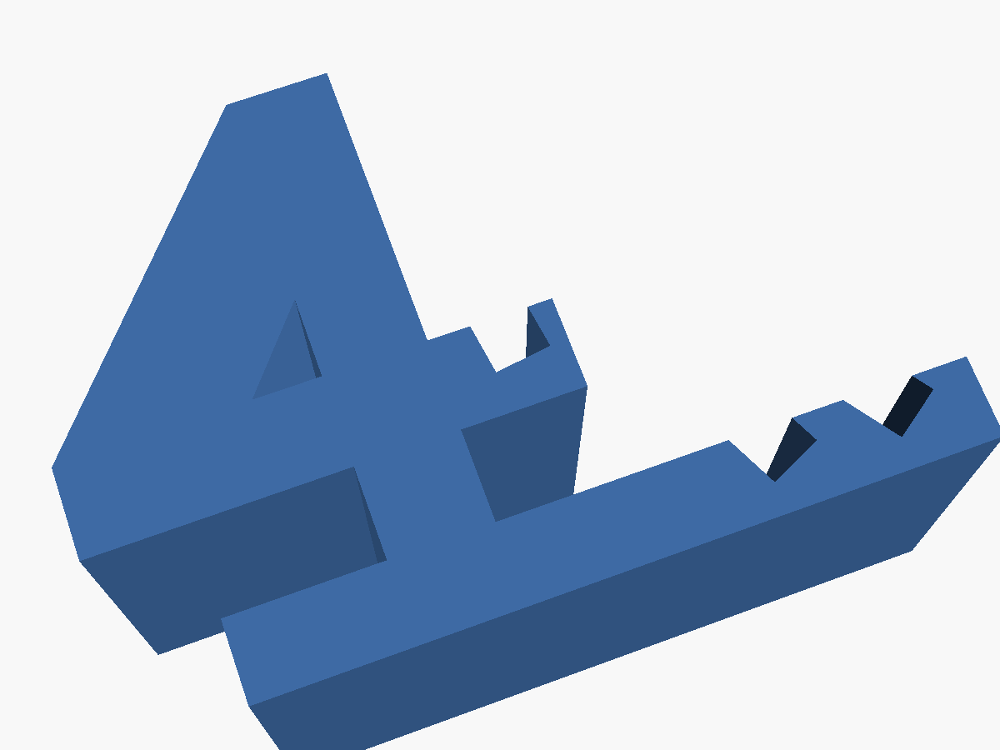

# Filuna CAD

**Modelagem e impressão 3D com IA, do pedido à peça impressa.** Um conjunto de habilidades (skills) para
assistentes como o Claude, mais os validadores que conferem a peça com números antes de gastar filamento.

Feito pela [Filuna 3D](https://filuna3d.com). Em português. Licença MIT.



## O que o assistente passa a fazer

| Habilidade | O que ensina |
|---|---|
| [`modelar`](skills/modelar/SKILL.md) | Entender o pedido, escolher o motor certo para o tipo de peça, modelar por código e conferir com números |
| [`projetar-para-imprimir`](skills/projetar-para-imprimir/SKILL.md) | Posição na mesa, parede, balanço, ponte, furos, primeira camada, resistência e material |
| [`validar`](skills/validar/SKILL.md) | Medir malha, apoio, balanço, parede e estabilidade; melhor posição na mesa; folha de vistas; comparar peças; raio-x contra uma imagem |
| [`calibrar`](skills/calibrar/SKILL.md) | Cupom de folga para a sua impressora e como levar a peça medida de volta ao modelo |
| [`fatiar-e-imprimir`](skills/fatiar-e-imprimir/SKILL.md) | Fatiar com segurança, várias cores, conferir o resultado e diagnosticar defeitos |
| [`ferramentas-filuna`](skills/ferramentas-filuna/SKILL.md) | As 23 ferramentas e paramétricos prontos do Filuna e quando usar cada um |
| [`filuna`](skills/filuna/SKILL.md) | A IA Filuna na conta do cliente: impressoras, erros, estoque, fatiar e imprimir |

O conhecimento está organizado de dois jeitos:

- **Por tipo de peça:** [qual motor usar](skills/modelar/references/escolher-motor.md) para peça mecânica,
  perfil extrudado, caixa, vaso, relevo de imagem, forma orgânica, articulado, multicor ou STL existente.
- **Por situação:** [receitas com números](skills/modelar/references/receitas.md) para folga de encaixe, caixa
  com tampa, trava, parafuso e inserto, rosca, dobradiça, texto, várias cores, suporte de objeto, ímã e peça
  maior que a mesa.

Motores cobertos: [OpenSCAD](skills/modelar/references/openscad.md),
[Python de malha](skills/modelar/references/python-malha.md) (shapely, Manifold, trimesh),
[build123d](skills/modelar/references/build123d.md) e [Blender](skills/modelar/references/blender.md), mais
[modelagem a partir de imagem](skills/modelar/references/a-partir-de-imagem.md).

## Instalar

**Claude Code**

```bash
claude plugin marketplace add abcollicelli-web/filuna-cad
```

```bash
claude plugin install filuna-cad@filuna
```

**Claude (aplicativo) e outros assistentes:** baixe este repositório em ZIP e envie como plugin, ou copie as
pastas de `skills/` para a pasta de habilidades do seu assistente. O arquivo [AGENTS.md](AGENTS.md) serve de
índice para assistentes que leem esse formato.

**Só os validadores** (Python 3.10 ou mais novo):

```bash
pip install "git+https://github.com/abcollicelli-web/filuna-cad#subdirectory=ferramentas"
```

## Validar uma peça

```bash
python -m filuna_cad validar peca.stl --mesa 256x256x256
```

```text
APROVADA  nota 92/100  suporte.stl
  malha: fechada, 136 triângulos, 520.972 cm³, [160.0, 110.0, 80.0] mm
  mesa: apoio 6512.2 mm², balanço 0.0 mm²
  parede: mínima 1.18 mm, 5% abaixo de 8.38 mm
  [aviso] Parede de 1.18 mm em [94.0, 43.92, 46.01]: imprime, mas é frágil se ficar solta.
```

```bash
python -m filuna_cad comparar a.stl b.stl
```

```bash
python -m filuna_cad raio-x peca.stl referencia.png --saida raio_x.png
```

- `validar` mede malha, apoio na mesa, balanço, espessura de parede, estabilidade e se cabe na impressora.
- `comparar` diz se duas peças são a mesma forma (sobreposição de volume de 0 a 1).
- `raio-x` compara a silhueta da peça com uma imagem de referência e pinta o que falta e o que sobra.
- `orientar` compara as seis posições na mesa e diz a melhor.
- `vistas` grava uma folha com perspectiva, frente, lado, cima e corte.
- `cupom` gera o teste de folga para a sua impressora.

O validador não fatia: tempo, gramas e suporte reais saem do fatiador. Os limites estão ditos em
[`validar`](skills/validar/SKILL.md).

## IA Filuna e ferramentas do site

O plugin já traz o conector da IA Filuna (`https://filuna3d.com/api/ia/mcp`). Quem tem conta no Filuna entra,
marca o que permite e o assistente passa a ver impressoras, erros, estoque e pedidos, a fatiar com o perfil
oficial da impressora e a mandar imprimir depois do sim.

- **Nada imprime sem confirmação**, e cada cliente só vê a própria conta.
- **Arquivos de modelos, paramétricos e ferramentas do Filuna são protegidos:** eles abrem e imprimem pelo
  Filuna Slicer, e o assistente nunca entrega arquivo, link ou G-code deles.
- **Conferir a peça do cliente:** a ferramenta `filuna_conferir_peca` roda os validadores deste repositório no
  servidor do Filuna sobre o arquivo que o próprio cliente enviou à Farm e devolve só medidas e avisos.
- **Sem conta no Filuna**, as habilidades de modelar, projetar, validar e fatiar funcionam do mesmo jeito.

As 23 ferramentas prontas (chaveiro com logo, foto para 3MF colorido, litofania, troféus, placa Pix, separar e
pintar cores, texturizador, vetorizador e outras) estão descritas em
[`ferramentas-filuna`](skills/ferramentas-filuna/SKILL.md). O código delas não faz parte deste repositório.

## Exemplo completo

[Suporte de celular em forma de "4"](exemplos/suporte-celular-4/): a mesma peça feita em três motores
(OpenSCAD, Python de malha e build123d), com a prova de que as três saem idênticas e o defeito que a validação
achou e o desenho corrigiu.

## O que tem de diferente

- Tudo em português, para quem imprime e não é engenheiro.
- Organizado por tipo de peça e por situação, com faixas de valores em vez de um número só.
- Um caminho por Python de malha (shapely, Manifold, trimesh), além de OpenSCAD, build123d e Blender.
- Raio-x de silhueta para medir uma peça contra uma foto de referência.
- Cupom de folga: um teste impresso de 20 minutos que dá a folga real da sua impressora.
- Melhor posição na mesa e folha de vistas com corte, sem abrir programa nenhum.
- Ligação com uma conta real de impressão (o Filuna) e com ferramentas prontas.

O que **não** está aqui: visualizador próprio, desenho técnico, simulação de esforço, placas de circuito e
controle direto de impressoras fora do Filuna.

## Limites, ditos com clareza

- Os números de folga, balanço e ponte são pontos de partida. A impressora, o material e a ventilação mudam
  tudo: imprima um pedaço de teste antes de uma peça grande.
- A tabela de temperaturas por material é de valores comuns de mercado, não medidos por nós.
- A instalação como plugin segue o formato do Claude Code, mas ainda não foi testada em todos os assistentes.
- Nenhuma validação substitui imprimir e usar a peça.

## Contribuir

Correções e receitas novas são bem-vindas, principalmente com medida de peça impressa: impressora, material,
folga usada e o que aconteceu. Veja [CONTRIBUTING.md](CONTRIBUTING.md).

## Licença

[MIT](LICENSE). As ferramentas e os modelos do site Filuna não fazem parte deste repositório e continuam
protegidos.
