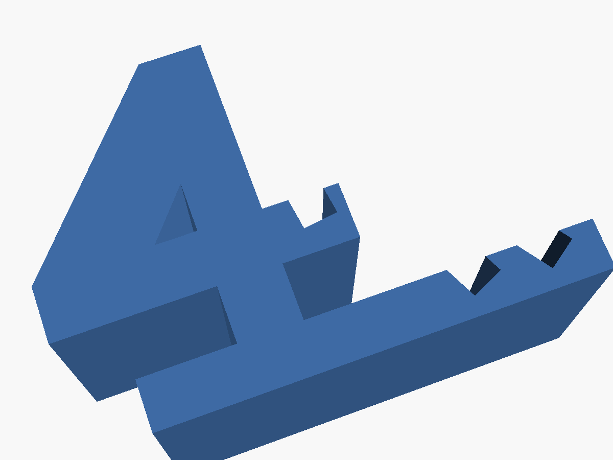
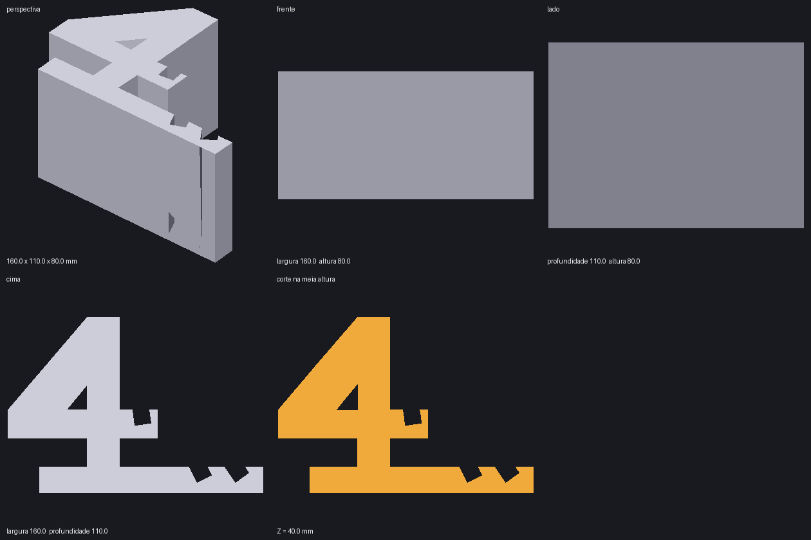

# Suporte de celular em forma de "4"

Um "4" com pé, de 160 × 110 × 80 mm, que segura o celular em três ângulos: 55, 65 e 82 graus. Imprime deitado
sobre a face do número, sem suporte.



A mesma peça foi feita em três motores, para mostrar que o resultado não depende do motor e que a validação
acha o que o olho não acha.

| Arquivo | Motor |
|---|---|
| [suporte4.scad](suporte4.scad) | OpenSCAD |
| [suporte4_filuna.py](suporte4_filuna.py) | Python de malha (shapely, Manifold, trimesh) |
| [suporte4_build123d.py](suporte4_build123d.py) | build123d |

## Como funciona

O celular apoia a base numa fenda de 11 mm e encosta as costas na quina do topo da haste do "4". O ângulo de
cada posição sai da linha entre a fenda e a quina, então a posição da fenda é calculada, não escolhida:

```text
x da fenda = x da quina + (altura da quina − altura da superfície) / tangente(ângulo)
```

Duas fendas ficam no pé (55 e 65 graus) e uma na barra do "4" (82 graus).



A folha acima sai de `python -m filuna_cad vistas`: o corte laranja mostra o perfil com as três fendas.

## O que foi medido

- **As três peças são a mesma:** `filuna_cad comparar` dá sobreposição 1,0 e diferença de medidas 0,0 mm entre a
  do OpenSCAD e a do Python de malha.
- **Malha:** fechada, 120 triângulos no OpenSCAD e 136 no Python de malha, 520,8 cm³.
- **Mesa:** 6.510 mm² de apoio, nenhum balanço.
- **Parede mínima:** 3,56 mm.
- **Validação:** aprovada, nota 100.
- **Posição:** `orientar` confirma que deitada sobre a face do número é a melhor das seis (balanço zero).
- **Fatiamento** (primeira versão, no fatiador do Filuna, Bambu Lab A1, PLA, camada de 0,20 mm): 4 h 42 min,
  160,7 g, sem suporte. A versão corrigida muda 0,1 cm³ e não foi fatiada de novo.

## O defeito que a validação achou

Na primeira versão a terceira fenda ficava a 80 graus, e a borda entre a fenda e a ponta da barra tinha
**1,18 mm**, solta de um lado: o ponto que quebraria ao encaixar o celular. As três peças tinham o defeito, a
imagem não mostrava e o fatiador aprovou. A validação acusou:

```text
[aviso] Parede de 1.18 mm em [94.0, 43.92, 46.01]: imprime, mas é frágil se ficar solta.
```

A correção foi mudar o ângulo para 82 graus, o que afasta a fenda da ponta e leva a parede a 3,56 mm.

## O que continua por melhorar

- A peça é maciça: 160 g e quase 5 horas. Um suporte de celular costuma ter de 30 a 60 g.
- A base de 160 × 80 mm ocupa bastante mesa.
- A quina onde o celular encosta é viva, sem arredondamento.
- Nada foi impresso: estabilidade e resistência são contas, não teste.

## Refazer

```bash
openscad --backend=manifold -o suporte4_openscad.stl suporte4.scad
```

```bash
python suporte4_filuna.py
```

```bash
python -m filuna_cad validar suporte4_openscad.stl
```
